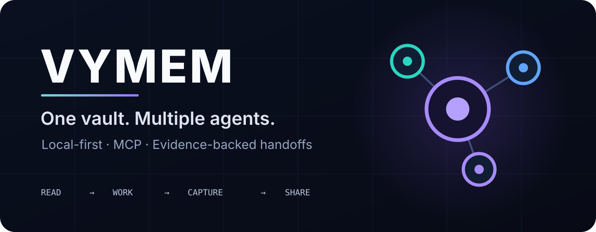
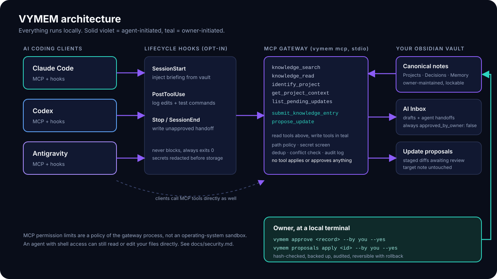
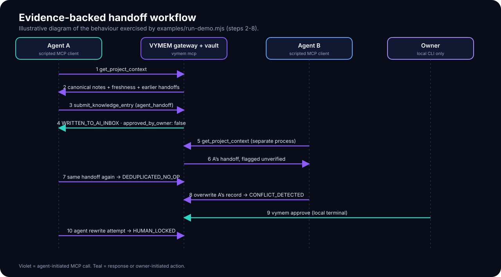
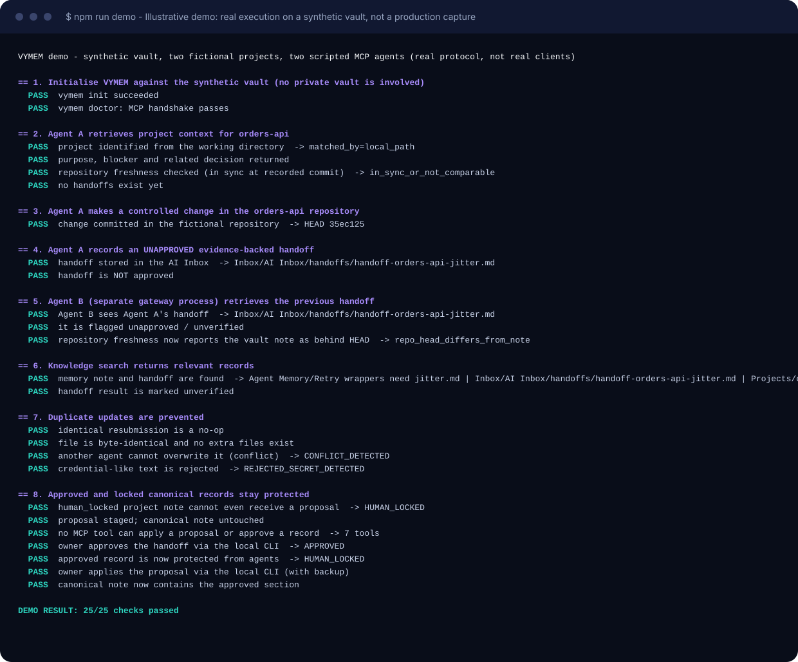
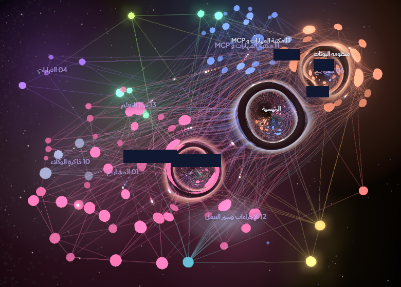
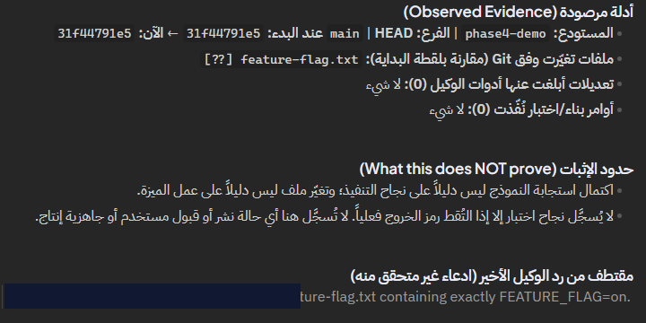

<p align="center">
  
</p>

<p align="center">
  <a href="https://github.com/abudoxali/Obsidian-Agent-Memory-Kit/actions/workflows/ci.yml"></a>
  <a href="LICENSE"></a>
  =20" src="https://img.shields.io/badge/node-%3E%3D20-339933?logo=node.js&logoColor=white">
  
</p>

# VYMEM - Shared Memory for Coding Agents

**VYMEM is a local-first toolkit that gives several AI coding agents one shared, evidence-backed memory: Markdown notes in your own Obsidian vault, served through a local MCP gateway, with owner-controlled approval of anything canonical.**

> **Status: early pre-release (v0.1.0), not production-ready.** The automated suite (45 tests), the synthetic demo and the privacy gate pass on Windows locally and in CI on Ubuntu, Windows and macOS with Node 20, 22 and 24 (see [Compatibility](docs/compatibility.md)). A real Claude Code binary has been verified to connect to the registered MCP server; **real-client lifecycle behaviour (hooks driving a live agent session) has not been validated** for any client. Licensed under [Apache-2.0](LICENSE). Read [Limitations](#limitations) before relying on it.

## The problem

Every coding-agent session starts cold. What one agent learned about a project (the retry bug it fixed, the decision not to use a library, the test that is flaky) is invisible to the next agent, to a different tool, and often to you. Pasting context by hand does not scale, and letting agents write freely into your notes ruins the notes.

## What VYMEM does

| Capability | How it works (implemented) |
| --- | --- |
| **Local MCP gateway** | `vymem mcp` - a stdio MCP server with 7 tools: search, read, identify project, project context, list proposals, submit entry/handoff, propose update. |
| **Obsidian Markdown storage** | Plain `.md` files with YAML frontmatter in a vault you choose. No database, no cloud. |
| **Project identification** | Maps a working directory to a git repository and to a project note by `local_path`, `repository_url`, name or alias. |
| **Automatic context** | Opt-in lifecycle hooks inject a short, secret-redacted briefing when a session starts. |
| **Evidence-backed handoffs** | When a session ends, a hook records git-observed changes and captured test commands as an **unapproved** handoff. It never claims a test passed unless the client reported an exit code. |
| **Shared AI Inbox** | Agents may write only drafts into one inbox folder. Deduplicated, secret-screened, conflict-checked, backed up, audited. |
| **Owner approval** | Agents can only *stage* proposals. Applying or approving is a local CLI action that is not reachable through MCP. Hash-checked, backed up, reversible. |
| **Freshness detection** | Compares a project note with the repository (`git` HEAD, `STATUS.md` hash and mtime) and flags notes that may be stale. |
| **Optional Sentinel** | Off by default. Writes a read-only draft snapshot of repositories under your workspace roots. |
| **Safe install / uninstall** | Merges into client configs, backs up first, idempotent, marker-based reversible uninstall. Nothing is registered without `--yes`. |

<p align="center">
   lifecycle hooks and MCP gateway -> Obsidian vault; owner approves canonical changes through a local CLI" width="100%">
</p>

## How shared memory works

1. **Read.** At session start (hook) or on demand (MCP), the agent gets the project's canonical notes, freshness signals, related decisions and lessons, pending proposals, and earlier **unapproved** handoffs - all marked as data, not instructions.
2. **Work.** The agent works as usual. Hooks (if enabled) log which files were edited and which build/test commands ran, with secrets redacted.
3. **Capture.** At the end, VYMEM writes a handoff containing only what it observed (git delta, commands, exit codes when available) plus the explicit list of what that does *not* prove.
4. **Share.** The next agent - possibly in a different tool - retrieves it. Nothing becomes canonical until **you** approve it.

<p align="center">
  
</p>

More detail: [How it works](docs/how-it-works.md) · [Architecture](docs/architecture.md).

## Supported AI clients

| Client | MCP registration | Lifecycle hooks | Verification level (details: [compatibility](docs/compatibility.md)) |
| --- | --- | --- | --- |
| Claude Code | `~/.claude.json` | `~/.claude/settings.json` | Config merge/uninstall and hook commands with **simulated** payloads (CI); **actual MCP connection verified** with the real Claude Code 2.1.319 binary in an isolated home (`claude mcp list`: Connected, one-off manual run). Hook lifecycle in a live session: **not verified**. |
| Codex | `~/.codex/config.toml` (marked block) | `~/.codex/hooks.json` | Simulated only (CI). Real client **not verified** (not installable for an isolated test here). Codex requires you to trust new hooks in its own UI. |
| Antigravity | `~/.gemini/config/mcp_config.json` | `~/.gemini/config/hooks.json` | Simulated only (CI). Real client **not verified** (GUI IDE; shares a global config). Hook behaviour on some platforms is reported to be inconsistent. |

Everything about versions and operating systems is in [docs/compatibility.md](docs/compatibility.md). Nothing is claimed as tested that was not.

## Installation

Requirements: **Node.js 20+** and (optionally, for project identification, freshness and hooks) **git**. VYMEM has no runtime dependencies and needs no administrator rights.

```bash
git clone https://github.com/abudoxali/Obsidian-Agent-Memory-Kit.git
cd Obsidian-Agent-Memory-Kit
node bin/vymem.mjs help
```

Examples below use `vymem` for `node /path/to/Obsidian-Agent-Memory-Kit/bin/vymem.mjs` (create a shell alias, or run `npm link` - standard npm, not exercised by this project's tests). Full guide: [docs/installation.md](docs/installation.md).

## Quick start

```bash
# 1. Point VYMEM at a vault (an existing Obsidian vault is fine; .obsidian is never touched)
vymem init --vault ~/Documents/MyVault --clients claude --workspace ~/code

# 2. Describe a project (or write the note by hand in Obsidian)
vymem project add my-service --path ~/code/my-service --summary "Billing API"

# 3. Preview, then register the MCP server with your client (nothing changes without --yes)
vymem install --client claude --mcp
vymem install --client claude --mcp --yes

# 4. Verify
vymem doctor

# 5. Optional: lifecycle hooks (briefing + automatic handoffs) - explicit consent required
vymem install --client claude --hooks --yes
```

Remove everything VYMEM added to client configs (your vault is never touched): `vymem uninstall --client all --yes`.

## Real usage examples

```bash
vymem search "retry idempotency"        # keyword search over your vault
vymem context my-service                # what an agent receives for a project
vymem handoffs --project my-service     # handoffs agents left behind
vymem freshness                         # which notes are behind their repositories
vymem proposals list                    # staged agent proposals
vymem proposals apply <id> --by you --yes
vymem approve <record-id> --by you --yes
```

Try the whole flow on a synthetic vault with two fictional projects:

```bash
npm run demo          # = node examples/run-demo.mjs
```

<p align="center">
  
</p>

<sub><b>Illustrative demo.</b> This is the real output of <code>examples/run-demo.mjs</code> (real vault, real git repositories, real MCP processes) on synthetic data. "Agent A" and "Agent B" are scripted MCP clients, not Claude Code or Codex sessions.</sub>

## Screenshots

VYMEM was extracted from a real, working private deployment (Obsidian + a local MCP gateway + agent hooks). The two images below are **real captures from that private deployment**, sanitized by the owner before publication (cropped, with opaque masks over project names). They show the *kind of workflow this kit reimplements*. They are **not** output of this standalone VYMEM release, and they say nothing about how VYMEM behaves with live clients - for that see [Compatibility](docs/compatibility.md).

<p align="center">
  
  <br><sub><b>Sanitized capture from a private deployment.</b> The vault rendered as a connected knowledge graph in Obsidian (graph plugin view). Project-name labels are masked; folder names are the deployment's own.</sub>
</p>

<p align="center">
  
  <br><sub><b>Sanitized capture from a private deployment.</b> A hook-written, <i>unapproved</i> handoff after an agent session in a fixture repository: git-observed evidence, an explicit "what this does not prove" section, no claimed test success. (A record identifier is masked; the note body is in Arabic, the original deployment's language.)</sub>
</p>

The synthetic, reproducible equivalent for this repository is the [demo above](#real-usage-examples). Provenance and review status of every visual: [docs/showcase](docs/showcase/README.md).

## Security model

- **Local only.** No network listener, no telemetry, no cloud calls. The gateway talks to its client over stdio.
- **Path policy.** Vault-relative `.md` paths only; no traversal, no symlink escape, no hidden folders, configurable blocked folders.
- **Agents cannot write canonical notes.** They write drafts to the inbox or stage proposals. Approved and `human_locked` notes reject agent writes.
- **Secrets** are screened on write and redacted on read (pattern based, best effort).
- **Every change** is backed up and audit-logged.

**Important:** MCP permission restrictions are a policy enforced by the VYMEM process. They are **not** operating-system sandboxing. An agent that can run shell commands can read your files directly - and can run `vymem approve` itself unless your client's command permissions prevent it. Read [docs/security.md](docs/security.md).

## Configuration

One JSON file (default: `%APPDATA%\vymem\config.json` on Windows, `~/.config/vymem/config.json` elsewhere; override with `--config` or `VYMEM_CONFIG`). Vault location, folder names, workspace roots, enabled clients, MCP permission (`read`/`propose`), hooks, scan exclusions, blocked folders, extra secret patterns, retention and Sentinel are all configurable. See [docs/configuration.md](docs/configuration.md).

## Testing

```bash
npm test               # 45 tests, node:test, no dependencies
npm run demo           # 25-check end-to-end demonstration
npm run audit:privacy  # release gate: personal data / credential / image-metadata scan
```

The suite runs against throwaway homes, vaults and git repositories, with a filesystem tripwire that fails any access to a private vault path. CI runs all three on Ubuntu, Windows and macOS with Node 20, 22 and 24 (9 of 9 jobs passed for commit `00e7fda`; the badge above shows the latest run). Automated CI is **not** real-client testing: see [docs/compatibility.md](docs/compatibility.md).

## Limitations

- No live-client lifecycle validation for any client (hooks driving a real agent session were not run); hook payload field names come from observations of one private deployment and may differ between client versions.
- Clients often do not report command exit codes to hooks; then test outcomes are recorded as "not captured" - never as passed.
- Search is keyword + synonym scoring, not semantic.
- The frontmatter reader supports a flat subset of YAML.
- `owner_agent` is a self-declared label, not authentication. The approval CLI has no authentication beyond running on your machine.
- Not implemented (by design or not yet): MCP tools that apply/approve, skills/MCP-registry discovery, scheduled-task installers, a GUI, cloud sync, semantic search.

Full list: [docs/security.md](docs/security.md#known-limitations) and [docs/compatibility.md](docs/compatibility.md).

## Contributing

Issues and pull requests are welcome; contributions are accepted under Apache-2.0 (see [License](#license)). Keep the dependency footprint at zero, never add features without tests, and run `npm test && npm run audit:privacy` before opening a PR. See [CONTRIBUTING.md](CONTRIBUTING.md).

## License

VYMEM is licensed under the **Apache License, Version 2.0** - see [LICENSE](LICENSE) (the unmodified text published by the Apache Software Foundation) and [NOTICE](NOTICE). Original source files carry an `SPDX-License-Identifier: Apache-2.0` header.

Apache-2.0 includes an express patent license (Section 3): each contributor grants a license under patent claims *they are able to license* that are necessarily infringed by their contribution, and that license terminates for anyone who sues alleging the work infringes a patent. It does not register or create any patent, and does not grant rights a contributor does not hold. Section 6 means the license does not grant permission to use the "VYMEM" name or logo, and no trademark registration or clearance is claimed.

Third-party material: none in the code (zero dependencies). The brand artwork was supplied by the owner for this project; the two screenshots depict third-party software UIs (Obsidian and a community plugin) and are published with the owner's approval - details in [NOTICE](NOTICE) and [docs/showcase](docs/showcase/README.md).

## Origin and naming

VYMEM is an independent re-implementation of the engineering ideas behind a private, personally-operated Obsidian + MCP knowledge system. No code history, notes, state or screenshots from that system are included. "VYMEM" is a working brand name: a preliminary search found no software or GitHub project with this exact name and the `vymem` npm name was unregistered when checked (2026-11-11), but similar marks exist and **no trademark clearance has been performed**. See [docs/brand/BRAND_IDENTITY.md](docs/brand/BRAND_IDENTITY.md).
